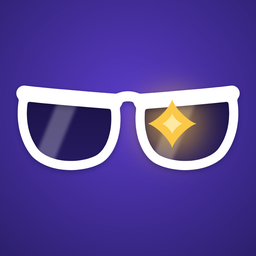
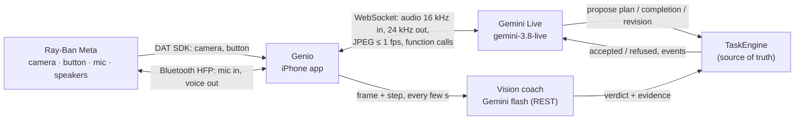

<p align="center">
  
</p>

<h1 align="center">Genio</h1>

<p align="center">
  <b>A hands-free coach for Ray-Ban Meta glasses.</b><br>
  Press the button on your glasses, say what you're doing, and Genio walks you through it step by step, watching through the camera, checking your progress and speaking up when you're done or about to get it wrong.
</p>

<p align="center">
  
  
  
  
  
</p>

---

## What it does

- **One button.** Press the capture button on your glasses: GENIO wakes up and you just talk ("I'm making coffee with a moka pot", "help me assemble this shelf"). Press again, or say "stop", to put it to sleep. The task is saved, even if you close the app, so the next press picks up where you left off.
- **A natural conversation.** Genio runs on [Gemini Live](https://ai.google.dev/gemini-api/docs/live-api): it hears you through the glasses' microphone, sees through their camera and answers in its own voice on the glasses' speakers. Interrupt it any time, as you would a person.
- **Step by step.** Gemini proposes a plan of 3 to 12 short steps; Genio's task engine validates it and guides you one step at a time. Say "done", "back", "new task", or ask "which screw?", "is this right?", "I have a different model": the plan adapts.
- **It checks your work.** A step moves on when you say so, or when the camera shows it done *consistently*: one look is never enough, so Genio would rather wait a few seconds than skip a step you haven't finished. A separate vision coach (a fast Gemini model) looks every few seconds and points out clear mistakes or hazards, cautiously. Silence is the default.
- **English and Italian.** The app's screens follow your iPhone's language; the voice language is set in the app.
- **No server.** The app talks straight to the glasses (Meta Wearables DAT SDK) and to Google's Gemini API. The API key stays in the iPhone's keychain.

## How it works



- **GlassesManager**: the DAT SDK session, the camera stream (only the latest frame is kept) and the capture button.
- **LiveConversationEngine**: one Gemini Live session over WebSocket. Microphone audio (16 kHz PCM) and sampled camera frames (JPEG, at most 1 per second) go in; Gemini's voice (24 kHz PCM), transcripts and function calls come out. Session resumption, context compression, goAway handling and reconnection with backoff keep it alive.
- **AudioManager**: the only owner of the audio session and engine: two-way Bluetooth hands-free audio with echo cancellation, immediate flush when you interrupt, and a check of the route iOS really picked (glasses or phone microphone).
- **TaskEngine** (in `Packages/GenioCore`): plans, steps, completion checks, observations and memory. Gemini and the coach only *propose*; the engine validates every proposal and is the only one that changes the task. It is saved to disk after every change.
- **CoachEngine**: the periodic vision coach, separate from the conversation, on its own Gemini model.

More in [docs/ARCHITECTURE.md](docs/ARCHITECTURE.md).

## Requirements

- A Mac with **Xcode 26.4+** and an iPhone on **iOS 18+**
- **Ray-Ban Meta** glasses with up-to-date software, paired with the iPhone as a Bluetooth audio device, and the **Meta AI** app with **Developer Mode** on (Meta AI → Settings → App Info → tap the version number 5 times → Developer Mode)
- A **Gemini API key** from [aistudio.google.com](https://aistudio.google.com/apikey) (pay as you go, or the free tier where available)

## Build and run

```bash
brew install xcodegen
git clone https://github.com/DavideWasTaken/Genio.git
cd Genio
cp Config/Local.xcconfig.example Config/Local.xcconfig   # then put your Team ID and a bundle id in it
xcodegen generate
open Genio.xcodeproj
```

Pick your iPhone in Xcode and press **Run**. Your Team ID is in Xcode → Settings → Accounts. A free Apple account works; the app then lasts 7 days on the phone before you reinstall it. `Config/Local.xcconfig` is git-ignored.

In the app:

1. **Link with Meta AI**: Meta AI opens to approve Genio.
2. **Connect glasses**: wear them and approve the camera in Meta AI. *Camera* and *Button* turn green.
3. ⚙️ **Settings → Gemini**: paste your Gemini API key and pick a voice. Optionally run **Test audio and camera** to check that iOS uses the glasses' microphone.
4. Press the button on your glasses and say what you're doing.

## Tests

The task engine, the Gemini Live protocol and session, the tools and the media pacing live in a Swift package with unit tests (mocked WebSocket and HTTP, no network):

```bash
cd Packages/GenioCore
swift test
```

Before trusting it on real hardware, go through [docs/HARDWARE-TEST-CHECKLIST.md](docs/HARDWARE-TEST-CHECKLIST.md).

## Talking to Genio

There are no fixed commands: talk as you would to a person. These work in English and Italian:

| | English | Italiano |
| --- | --- | --- |
| Start a task | "help me fix the coffee machine" | "aiutami a pulire il filtro" |
| Next step | "done", "next" | "fatto", "avanti" |
| Previous step | "go back" | "torna indietro" |
| Start over | "new task" | "nuovo compito" |
| Pause | "stop", "that's all" | "stop", "basta" |
| Questions | "which screw?", "is this right?", "I can't find the button" | "quale vite?", "è giusto così?", "non trovo il pulsante" |

"Done", "back", "new task" and "stop" only count if the microphone transcript shows you said them: Gemini cannot invent them.

## Cost

Gemini Live is billed per token of audio, video and text (see [ai.google.dev/pricing](https://ai.google.dev/pricing)); the vision coach adds one small image request every few seconds while a step is in progress. Settings → *Log* shows the session's tokens as Gemini reports them while GENIO is on.

## Status and caveats

Genio is an early, personal project. Things to know:

- **Not a safety device.** Warnings are best effort and cautious; Genio can miss things or be wrong.
- **Personal prototype authentication.** The app uses your Gemini API key directly from the phone. That is fine for your own builds; a public release should mint short-lived [ephemeral tokens](https://ai.google.dev/gemini-api/docs/live-api/ephemeral-tokens) on a small backend instead of shipping or storing long-lived keys.
- **Bluetooth audio while the camera streams** must be checked on your hardware: some glasses or firmware may move audio between profiles while DAT streams video. The audio test in Settings and the on-screen microphone indicator show what iOS really uses.
- **Inputs is experimental** in DAT SDK 1.0: fine for development and beta builds, not yet allowed in App Store releases. That's why Genio is built and installed from source.
- **The glasses' own software must be current.** An older DAT component on the glasses refuses the session (`datAppOnTheGlassesUpdateRequired`); Genio shows an update button.
- **Stopping with the button.** While the camera streams (GENIO on), the glasses keep the capture button for their own photo and video actions and do not pass the press to the app. Genio treats the photo that the glasses report as the stop signal (the photo is still taken). Saying "stop" or hanging up the "Genio" call (Dynamic Island, or the glasses' end-call gesture) also switches it off.
- **Battery.** The glasses' camera streams only while GENIO is on (or the camera test is open); idle, they keep just the button.
- **In the background.** A GENIO session runs as a call (CallKit): iOS only lets an app switch the microphone on from the background during a call, so the glasses' button can start GENIO with the phone in a pocket. You see "Genio" as a call in the Dynamic Island; hanging up there switches GENIO off. With GENIO on, Genio keeps working with the screen locked. With GENIO off and the glasses connected, Genio keeps a silent audio session open (mixed with your music) so iOS does not suspend it and the glasses' button still works; it costs a little phone battery. iOS can still end the app (low memory, force-quit); the task is saved either way.
- **Sessions.** Gemini Live connections last about 10 minutes; Genio moves to a new one with session resumption, so the conversation goes on. If resumption fails, Genio sends the task state again.

## Privacy

There's no Genio server. Microphone audio, sampled camera frames, transcripts and your task go only to Google's Gemini API while GENIO is on, under Google's terms. The API key is stored in the iPhone keychain. The task is saved on the phone (Application Support). The on-screen *Log* (Settings → Log) stays on the phone.

## Project layout

| File | What it does |
| --- | --- |
| `Genio/GlassesManager.swift` | DAT SDK: registration, device session, camera (latest frame, off-main JPEG), button |
| `Genio/LiveConversationEngine.swift` | The Gemini Live conversation: audio, video sampling, transcripts, function calls |
| `Genio/AudioManager.swift` | Audio session and engine: HFP two-way audio, echo cancellation, playback, route checks |
| `Genio/CoachEngine.swift` | The periodic vision coach |
| `Genio/GenioController.swift` | GENIO on/off, wiring, task events |
| `Genio/Voice.swift` | Chimes, and the iOS voice for lines Gemini cannot say (no key, no connection) |
| `Genio/ContentView.swift` · `SettingsView.swift` · `Theme.swift` | SwiftUI screens, audio and camera tests |
| `Genio/Localizable.xcstrings` | Italian translation of the UI |
| `Packages/GenioCore/Sources/GenioCore/Task` | `TaskEngine`, `CompletionVerifier`, `GenioTask`, persistence |
| `Packages/GenioCore/Sources/GenioCore/Live` | Gemini Live wire format, `GeminiLiveSession`, `TaskTools`, instructions |
| `Packages/GenioCore/Sources/GenioCore/Coach` | `GeminiVisionCoach` (REST) and model selection |
| `Packages/GenioCore/Sources/GenioCore/Media` | `FramePacer`, PCM helpers |
| `tools/make_icon.py` | Draws the app icon |

## Credits

- Built on the [Meta Wearables Device Access Toolkit](https://github.com/facebook/meta-wearables-dat-ios). Using it means agreeing to the [Meta Wearables Developer Terms](https://wearables.developer.meta.com/terms) and [Acceptable Use Policy](https://wearables.developer.meta.com/acceptable-use-policy).
- Conversation, voice and vision by [Google Gemini](https://ai.google.dev).
- Inspired by [VisionClaw](https://github.com/Intent-Lab/VisionClaw) (no code from it is used).

Genio is an independent project, not affiliated with or endorsed by Meta, Ray-Ban or Google.

## License

[MIT](LICENSE)
