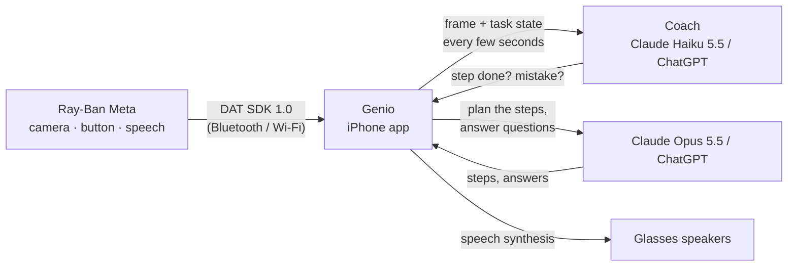

<p align="center">
  
</p>

<h1 align="center">Genio</h1>

<p align="center">
  <b>A hands-free coach for Ray-Ban Meta glasses.</b><br>
  Press the button on your glasses, say what you're doing, and Genio walks you through it step by step, watching through the camera and speaking up when you're done or about to get it wrong.
</p>

<p align="center">
  
  
  
  
</p>

---

## What it does

- **One button.** Press the capture button on your glasses: GENIO wakes up and asks what you're doing ("making coffee with a moka pot", "assembling this shelf"). Press again, or say "Genio stop", to put it to sleep. The task is kept, so the next press picks up where you left off.
- **Step by step, in your ears.** The model turns your task into short, concrete steps and reads you one at a time. Say "done", "repeat", "back" or "new task".
- **A coach that watches.** Every few seconds a fast model looks at what your glasses see. When a step is clearly done it gives you the next one; if it spots a mistake or a hazard (heat, a blade, the wrong part) it tells you. Silence is the default.
- **Quick questions, any time.** "Genio, what's this screw for?" gets a short spoken answer about what you're looking at, even while GENIO is asleep.
- **Your choice of brain.** Claude with an API key (a few cents an hour), or ChatGPT on your own Plus/Pro plan via *Sign in with ChatGPT*, with Claude as an automatic backup.
- **English and Italian.** The app's screens follow your iPhone's language. The voice language (what Genio says, understands and answers in) is set separately in the app.
- **No server.** The app talks straight to the glasses (Meta Wearables DAT SDK) and to the model provider. Keys and tokens stay in the iPhone's keychain.

## How it works



- **Button**: the DAT SDK's *Inputs* capability reports capture-button presses (short, double, long; your pick).
- **Voice**: the DAT SDK's *Speech* capability transcribes on the glasses themselves, so only text crosses the link. Genio listens for its name and a handful of exact commands.
- **Eyes**: the glasses camera streams at 504×896, 7 fps; Genio keeps only the latest frame and sends one to the model when it needs to look.
- **Mouth**: iOS speech synthesis, played to the glasses as Bluetooth audio.

## Requirements

- A Mac with **Xcode 26.4+** and an iPhone on **iOS 18+**
- **Ray-Ban Meta** glasses with up-to-date software, and the **Meta AI** app with **Developer Mode** on (Meta AI → Settings → App Info → tap the version number 5 times → Developer Mode)
- One of:
  - a **Claude API key** from [console.anthropic.com](https://console.anthropic.com) (pay as you go), or
  - a **ChatGPT Plus or Pro** plan, for *Sign in with ChatGPT* (preview)

## Build and run

```bash
brew install xcodegen
git clone https://github.com/DavideWasTaken/genio.git
cd genio
cp Config/Local.xcconfig.example Config/Local.xcconfig   # then put your Team ID and a bundle id in it
xcodegen generate
open Genio.xcodeproj
```

Pick your iPhone in Xcode and press **Run**. Your Team ID is in Xcode → Settings → Accounts. A free Apple account works; the app then lasts 7 days on the phone before you reinstall it. `Config/Local.xcconfig` is git-ignored.

In the app:

1. **Link with Meta AI**: Meta AI opens to approve Genio.
2. **Connect glasses**: wear them and approve camera and microphone in Meta AI. *Camera*, *Button* and *Voice* turn green.
3. ⚙️ **Settings**: choose the brain and paste your Claude key, or sign in with ChatGPT.
4. Press the button on your glasses.

## Voice commands

| | English | Italiano |
| --- | --- | --- |
| Ask anything | "Genio, …" | "Genio, …" |
| Next step | "done", "next" | "fatto", "avanti" |
| Repeat the step | "repeat" | "ripeti" |
| Previous step | "back" | "indietro" |
| Start over | "new task" | "nuovo compito" |
| Go to sleep | "Genio stop" | "Genio stop", "basta" |

Commands are matched as whole phrases, so "I made a mistake" never counts as "done". Anything else said while GENIO is on is ignored: questions start with "Genio".

## Cost

| | Model | Rough cost |
| --- | --- | --- |
| Coach (every 6 s, adjustable) | Claude Haiku 5.5 | ~10–15 US cents per hour of GENIO on |
| Plans and questions | Claude Opus 5.5 (or Sonnet / Haiku) | ~1 cent each |
| With *Sign in with ChatGPT* | your plan's models | included in your plan (Plus: 5-hour usage window) |

These are estimates. For Opus and Sonnet the app turns on Anthropic's server-side refusal fallback (`fallbacks: "default"`).

## Status and caveats

Genio is an early, personal project. Things to know:

- **Inputs and Speech are experimental** in DAT SDK 1.0: fine for development and beta builds, but not yet allowed in App Store releases. That's why Genio is built and installed from source.
- **The glasses' own software must be current.** An older DAT component on the glasses refuses the session (`datAppOnTheGlassesUpdateRequired`); Genio shows an update button.
- **Short press** may also take a photo with some glasses software. If it does, switch to double or long press in Settings.
- **On-glasses speech** follows the language Meta's recognizer supports; check *Heard* on the main screen.
- **Sign in with ChatGPT** only accepts a loopback (`http://127.0.0.1`) redirect. Genio serves it from inside the app during sign-in. OpenAI's docs don't mention iOS, so treat it as experimental.
- **Keep the app open.** While GENIO is on the screen stays awake; in the background iOS may pause the coach.

## Privacy

There's no Genio server. Camera frames, transcripts and your task go only to the model provider you choose (Anthropic or OpenAI) when Genio needs an answer, under that provider's terms. The Claude key and ChatGPT tokens are stored in the iPhone keychain. The on-screen *Log* (Settings → Diagnostics) stays on the phone.

## Project layout

| File | What it does |
| --- | --- |
| `Genio/Glasses.swift` | DAT SDK: registration, device session, camera (latest frame only), button (Inputs), speech (Speech), permissions |
| `Genio/GenioController.swift` | GENIO mode, voice commands, "Genio, …" questions, the coach loop |
| `Genio/VoiceLanguage.swift` | Spoken lines and commands in English and Italian |
| `Genio/Brain.swift` | The brain interface, shared prompts, ChatGPT → Claude fallback |
| `Genio/ClaudeBrain.swift` | Claude over the Messages API |
| `Genio/ChatGPTBrain.swift` · `ChatGPTAuth.swift` | ChatGPT over the Responses API; *Sign in with ChatGPT* (OAuth PKCE, loopback listener, token refresh) |
| `Genio/Voice.swift` | Speech synthesis and the wake/sleep chimes |
| `Genio/ContentView.swift` · `SettingsView.swift` · `Theme.swift` | SwiftUI screens |
| `Genio/Localizable.xcstrings` | Italian translation of the UI |
| `tools/make_icon.py` | Draws the app icon |

## Credits

- Built on the [Meta Wearables Device Access Toolkit](https://github.com/facebook/meta-wearables-dat-ios). Using it means agreeing to the [Meta Wearables Developer Terms](https://wearables.developer.meta.com/terms) and [Acceptable Use Policy](https://wearables.developer.meta.com/acceptable-use-policy).
- Models by [Anthropic](https://www.anthropic.com) (Claude) and [OpenAI](https://openai.com) (ChatGPT).
- Inspired by [VisionClaw](https://github.com/Intent-Lab/VisionClaw).

Genio is an independent project, not affiliated with or endorsed by Meta, Ray-Ban, Anthropic or OpenAI.

## License

[MIT](LICENSE)
