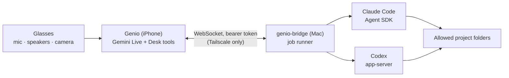

# Genio Desk: a bridge to Claude Code and Codex (design)

Status: **design only**, nothing is implemented. This document records what
the bridge should be before any code is written.

## Goal

From the glasses, by voice, hand work to a coding agent running on your own
computer, follow it, approve what it wants to do and hear the result:

> "Genio, ask Claude to fix the failing test in the Genio repo."
> *(two minutes later)* "Claude has finished: the test was comparing dates in
> the wrong time zone, it changed one file and now all 61 tests pass. Should
> it commit?"

Gemini Live stays the voice and the "boss": it understands the request, picks
the agent and the project, relays questions and reads results aloud. The
agents (Claude Code, Codex) do the work on the computer, with their own
permission systems. Genio never gets a shell.

This is a separate mode, **Genio Desk**, switched on in Settings. Without it
none of the tools below are declared and the app behaves as today. The task
coach and the bridge do not mix: Desk jobs are not task steps.

## Architecture

- **genio-bridge**: a small daemon on the Mac (TypeScript/Node, because both
  agent SDKs are first-class there). It owns the agent processes, keeps jobs
  and their events, and enforces the rules below. It is the only thing the
  phone talks to.
- **Network**: the bridge listens only on the Tailscale interface (or
  localhost behind `tailscale serve`), never on 0.0.0.0, never on the
  internet. Tailscale gives encryption and device identity; a Tailscale ACL
  limits the port to the iPhone.
- **Pairing**: the bridge prints a QR code with its tailnet address and a
  random 256-bit token; the app scans it and stores the token in the Keychain
  (like the Gemini key). Every request carries `Authorization: Bearer`. The
  token can be rotated from the bridge (`genio-bridge pair --rotate`).

## What Gemini can call (Desk mode)

All `BLOCKING`, like the task tools, so Gemini waits for the bridge's answer
before speaking.

| Function | Purpose | Bridge checks |
| --- | --- | --- |
| `list_projects` | names and agents available ("genio", "website") | — |
| `delegate_to_computer(agent, project, instruction)` | starts a job; returns `job_id` at once | project in the allowlist; agent installed and logged in; one running job per project |
| `job_status(job_id?)` | state, last progress line, pending question | — |
| `answer_agent(job_id, decision, user_words)` | approve / deny a pending permission request, or answer a question | `user_words` must match the microphone transcript of the last 20 s (same rule as `user_confirmed_step`) |
| `follow_up(job_id, instruction)` | continues the same agent session ("now commit it") | job finished or idle |
| `cancel_job(job_id)` | stops the job | — |

Gemini never sees file contents unless the agent puts them in its summary;
the bridge sends short, speakable text.

Jobs take minutes, so they are asynchronous: the phone keeps a WebSocket to
the bridge, and events (`progress`, `needs_approval`, `finished`, `failed`)
are injected into the Live session as short text turns, the same way step
events are today ("Claude needs approval to run: npm install. Ask the
user."). Gemini decides when to speak them so it does not talk over the user.

When GENIO is off, jobs keep running on the Mac. Results wait in the bridge;
the next GENIO start lists finished jobs in the system instruction (as memory
does), and Genio opens with them. Push notifications would need a server
(APNs) and are out of scope for the prototype.

## Agents

### Claude Code: Agent SDK (TypeScript)

`@anthropic-ai/claude-agent-sdk`, `query()` with:

- `cwd`: the project folder from the allowlist.
- `permissionMode: "default"` (or `"acceptEdits"` per project if the user
  wants edits inside the project to flow without asking); never
  `bypassPermissions`.
- `canUseTool`: every request that reaches it becomes a `needs_approval`
  event; the promise resolves when `answer_agent` arrives, or denies after a
  timeout (default 3 minutes) with a message the model can understand.
- `disallowedTools`: `Bash(git push *)`, `Bash(sudo *)`, `Bash(rm -rf *)` and
  similar, as a first layer; a `PreToolUse` hook as a second layer for checks
  that need code. Both deny even when a mode would allow.
- Bash sandbox enabled in the project's settings
  (`sandbox.enabled`, `failIfUnavailable`, write access only to the project,
  a short list of allowed domains).
- `maxTurns` and `maxBudgetUsd` per job.
- An appended system prompt asking for a final two-sentence summary written
  to be spoken.
- `resume: session_id` for `follow_up`.
- `interrupt()` / `close()` for `cancel_job`.

Events come from the message stream: `system/init` (session id), `assistant`
text and `tool_use` blocks (progress lines such as "running the tests"),
`result` (summary, `subtype`, cost estimate, `permission_denials`).

**Which interface.** Two options, both official:

- the `claude` CLI in `-p` mode with `--output-format stream-json`
  (`--resume <session_id>` to continue): it uses the subscription you are
  logged in with on the Mac (`claude` → `/login`), the path the headless docs
  present as normal;
- the Agent SDK, with a richer permission callback (`canUseTool`).

For a personal bridge the CLI is the default: same login as at the desk, no
API key. Permission requests then go through a `PreToolUse` hook that asks
the bridge (and waits for the voice answer) instead of `canUseTool`.

**Authentication.** In `-p`/SDK mode `ANTHROPIC_API_KEY`, when present,
always wins over the subscription login. The bridge checks
`claude auth status --json` at startup and refuses to start if the method is
not the one configured, and it clears the variable unless the API-key mode
is chosen. The Agent SDK documentation does not allow third-party products
to offer claude.ai login; for a personal bridge on your own Mac this is
unclear, so the conservative default is an Anthropic API key in the Mac's
keychain. Distributing the bridge would need that settled first.

Remote Control is **not** an integration point: only Anthropic's own apps
can connect to it. The bridge offers the same thing for its own sessions
(below).

## Logins and sessions

- **Logins**: the bridge uses the logins already on the Mac and never stores
  or copies them: `claude` (subscription, `/login`) and `codex login`
  (ChatGPT account). `genio-bridge doctor` reports which method each agent
  will use (`claude auth status --json`, Codex's login status) before any job.
- **Sessions are ordinary agent sessions.** Claude Code keeps them on the
  Mac and `claude --resume <id>` opens them in a terminal; Codex threads are
  resumable with `codex resume`. So a job started from the glasses can be
  continued at the desk, and a session started at the desk can be continued
  from the glasses ("riprendi la sessione di ieri sul repo Genio").
- The bridge keeps a small index (session id, agent, project, title, last
  summary, time) so Gemini can list and pick sessions by voice:
  `list_sessions(project?)`, and `follow_up` takes a session as well as a
  job.

### Codex: app-server (JSON-RPC)

`codex app-server` over stdio, driven by the bridge:

- `thread/start` with `cwd` (allowlisted project), `sandbox: workspace-write`,
  approval policy `on-request`;
- `turn/start` with the instruction; `thread/resume` for `follow_up`.

Approval requests (`item/commandExecution/requestApproval`, file changes)
become `needs_approval` events; the bridge answers `accept`, `decline` or
`cancel`. Streamed items give progress; `turn/completed` gives the result.
Codex reuses its own login (`~/.codex/auth.json`, ChatGPT or API key); the
bridge never reads or copies it.

The app-server stays on stdio: it is never exposed on a network port.
`codex exec --json` (one-shot, JSONL events) is a simpler fallback for
read-only questions.

## Safety rules

1. **No shell endpoint.** The bridge offers jobs, not commands. Everything an
   agent runs passes through that agent's own permission system.
2. **Project allowlist.** Folders are listed in the bridge's config file on
   the Mac; voice can choose among them, never type a path.
3. **Voice approval with proof.** An approval counts only if the user's words
   are in the microphone transcript, so Gemini cannot approve on its own.
   Destructive or outward actions (push, deploy, delete outside the project,
   network installs, sending anything) always ask, whatever the mode.
4. **Credentials are the real boundary.** The bridge's environment has no
   push credentials by default; `git push` is denied by rule. A future
   "publish" step would be its own explicit, approved bridge action.
5. **Limits.** Turns, budget and wall time per job; one job per project;
   cancel by voice ("cancel the job") or from the phone.
6. **Logs stay local.** The bridge keeps job events on the Mac and sends the
   phone only summaries and approval prompts. Nothing is logged with tokens
   or keys.
7. "Genio stop" switches GENIO off, as today; it does **not** cancel jobs
   (explicit cancel only), so you can walk away while the agent works.

## On the phone

- Settings → Genio Desk: on/off, pair (QR), bridge status, the default agent.
- Home: when a job runs, one compact card (agent, project, state, the pending
  approval with Approve / Deny buttons as a fallback to voice). Nothing more,
  in line with the clean home screen.

## Ideas for later

- **"Send what I see."** A camera frame (whiteboard, error on another
  screen, a device label) attached to the job as an image.
- **Read-only questions first.** "What is failing in CI?", "explain
  GeminiLiveSession": plan mode / read-only sandbox, no approvals needed.
- Pick up a Desk job from memory ("how did the Genio fix go?").

## Plan

1. Bridge alone, tested from a terminal with `curl`/`websocat`: pairing,
   allowlist, one Claude job read-only, events.
2. Approvals end to end with Claude (`canUseTool`), timeout and cancel.
3. Codex adapter on the same job model.
4. App: Desk mode, the six tools, event injection, the job card.
5. Hardware test on the glasses; then edits with approval in a real repo.

## Open questions

- Exact stdin framing of `claude -p --input-format stream-json`, if the CLI is
  used instead of the SDK.
- Whether subscription usage counts the same in SDK runs (`/usage` windows).
- Whether a single bridge job should be able to use both agents (for
  example Codex reviews what Claude wrote), or one agent per job.
